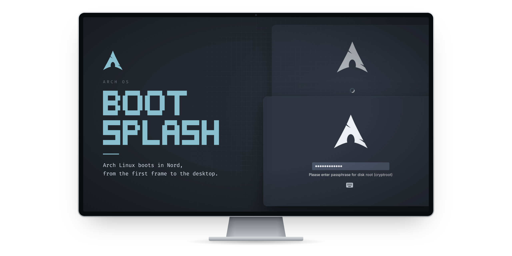

<div align="center">



<p><b>Arch Linux</b> boots in Nord,<br>from the first frame to the desktop.</p>

**[➜ Arch OS](https://github.com/murkl/arch-os)** · **[➜ Contributing](CONTRIBUTING.md)**

<p>
  <a href="https://aur.archlinux.org/packages/plymouth-theme-arch-os"></a>
  <a href="https://github.com/murkl/plymouth-theme-arch-os/releases/latest"></a>
  <a href="../LICENSE"></a>
</p>

</div>

## Features

- Arch logo and spinner on Nord
- Password prompt with keyboard layout and Caps Lock
- Progress for updates, upgrades and resets
- Boot messages on Esc, in the same colors
- Logo and spinner fade out at the end

## Installation

From the **[AUR](https://aur.archlinux.org/packages/plymouth-theme-arch-os)**, with paru or yay:

```sh
paru -S plymouth-theme-arch-os
sudo plymouth-set-default-theme -R arch-os
```

**Note:** _Plymouth has to be set up first. **[➜ Arch Wiki](https://wiki.archlinux.org/title/Plymouth)**_

<br>

<p align="center"><sub>The Arch Linux logo is a trademark of Arch Linux, used under its <a href="https://terms.archlinux.org/docs/trademark-policy/">trademark policy</a>.</sub></p>
